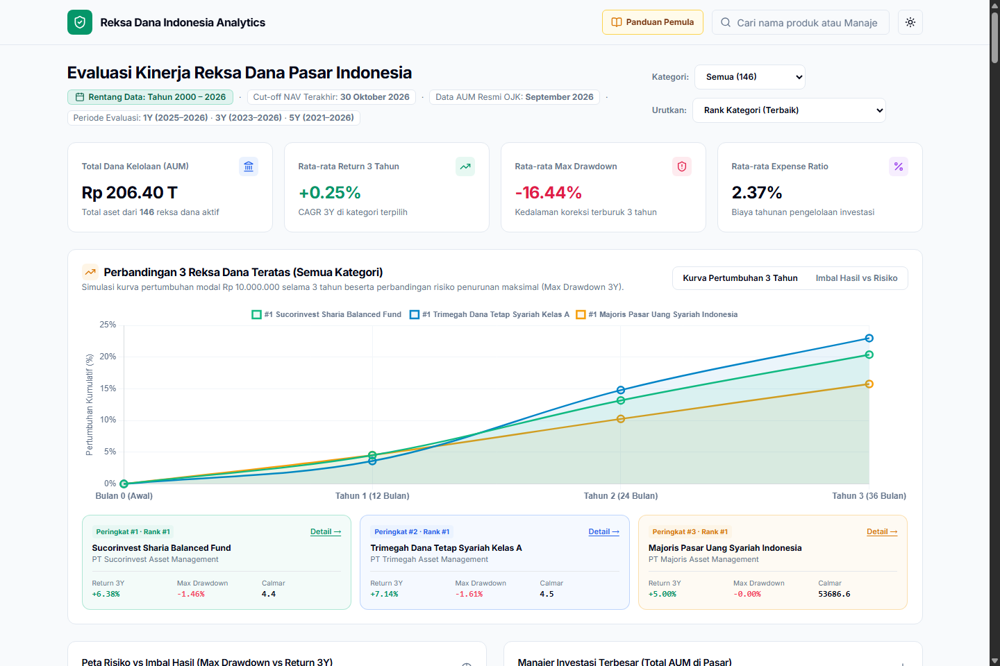
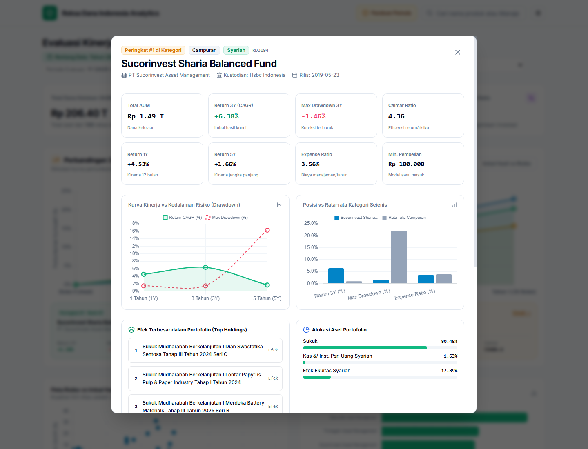
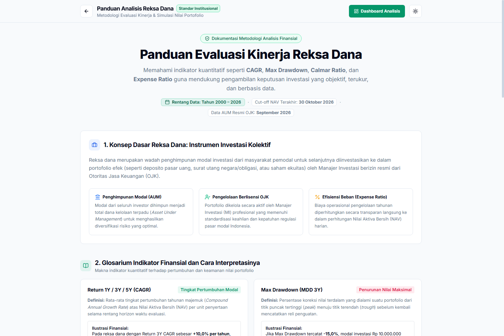

# 📈 Platform Analisis Kuantitatif Reksa Dana Pasar Modal Indonesia
### *Next-Gen Institutional Multi-Criteria Scoring & Interactive Analytics Dashboard*


Platform analitik kuantitatif interaktif berbasis web untuk mengevaluasi, membandingkan, dan memeringkatkan **146 Reksa Dana Aktif & Tradeable** di pasar modal Indonesia secara adil (*anti-bias*) menggunakan metodologi *Peer-Group Segmentation*, *Max Drawdown*, dan *Calmar Ratio*.

---

## 📸 Antarmuka Platform & Tangkapan Layar

### 1. Dashboard Analisis Utama
Menampilkan indikator utama pasar, filter kategori aset, pengurutan cerdas, dan kurva pertumbuhan modal terintegrasi untuk 3 Reksa Dana teratas:


### 2. Modal Dialog Analisis Mendalam & Portofolio
Menyajikan 8 metrik finansial esensial, kurva kinerja multi-periode (1Y, 3Y, 5Y), perbandingan vs rata-rata kategori (*peer group*), alokasi aset, serta 5 efek portofolio terbesar (*top holdings*) dengan format penulisan baku dan rapi:


### 3. Portal Panduan Edukasi & Kalkulator Simulasi Investor
Buku panduan edukatif berstandar institusional yang menjelaskan konsep reksa dana, glosarium metrik kuantitatif, dan kalkulator simulasi nominal investasi interaktif:


---

## 📅 Cakupan Periode & Rentang Waktu Data

Seluruh kalkulasi dan simulasi pada platform ini dibangun menggunakan data historis pasar modal Indonesia dengan parameter waktu yang transparan dan dapat diverifikasi:

| Parameter Metrik | Rentang Waktu / Tanggal | Penjelasan Teknis |
| :--- | :--- | :--- |
| **Tanggal Cut-off NAV Harian** | **29 – 30 Oktober 2026** | 135 reksa dana dicatat per **30 Oktober 2026** dan 12 reksa dana per **29 Oktober 2026** (hari bursa aktif terakhir). |
| **Tanggal Laporan Resmi AUM** | **September 2026** | Mengikuti siklus publikasi resmi bulanan Otoritas Jasa Keuangan (OJK) dan KSEI. |
| **Rentang Peluncuran (*Inception*)** | **Tahun 2000 – 2026** | Mencakup reksa dana tertua berumur **26 tahun** (seperti *BNP Paribas Pesona*, *Schroder Dana Prestasi*, *Batavia Dana Saham* yang diluncurkan sejak 5 Januari 2000) hingga reksa dana emisi baru Juli 2026. |
| **Horizon Kinerja 1 Tahun (1Y)** | **Oktober 2025 – Oktober 2026** | Mengukur imbal hasil jangka pendek tahunan (*CAGR 1Y*). |
| **Horizon Kinerja 3 Tahun (3Y)** | **Oktober 2023 – Oktober 2026** | Horizon evaluasi primer untuk kalkulasi imbal hasil majemuk (*CAGR 3Y*), penurunan terdalam (*Max Drawdown 3Y*), dan *Calmar Ratio*. |
| **Horizon Kinerja 5 Tahun (5Y)** | **Oktober 2021 – Oktober 2026** | Mengukur ketahanan modal jangka menengah-panjang melintasi berbagai siklus suku bunga Bank Indonesia. |
| **Sumber Data Primer** | **OJK, KSEI, & Bibit API** | Registri resmi produk investasi reksa dana terdaftar dan diawasi OJK. |

---

## 🚀 Keunggulan Metodologi Kuantitatif (Next-Gen Model)

Model evaluasi konvensional sering kali tidak adil karena membandingkan seluruh reksa dana dalam satu wadah global, sehingga reksa dana pasar uang berisiko nol terdepak oleh reksa dana saham yang berfluktuasi tinggi. Platform ini menerapkan **3 Pilar Penyempurnaan Model Institusional**:

1. **Anti-Bias Kategori (*Peer-Group Segmentation*):**  
   Evaluasi dan perankingan dinilai secara terpisah di dalam masing-masing habitat kelas asetnya (*Pasar Uang vs Pasar Uang, Obligasi vs Obligasi, Saham vs Saham, Campuran vs Campuran*).
2. **Keseimbangan Imbal Hasil vs Risiko (*Calmar Ratio & Max Drawdown 3Y*):**  
   Tingkat penurunan nilai maksimal (*Max Drawdown*) diintegrasikan sebagai pengurang skor utama, dan *Calmar Ratio* digunakan untuk mengukur efisiensi imbal hasil per unit risiko penurunan.
3. **Filter Kelayakan Likuiditas (*AUM Liquidity Penalty*):**  
   Reksa dana dengan dana kelolaan kecil di bawah ambang batas likuiditas sehat (< Rp 25 Miliar) dikenakan penalti diskon skor untuk memitigasi risiko pembubaran produk (*fund liquidation*).

---

## 📐 Metodologi Kuantitatif, Perhitungan, & Rumus Finansial

Model penilaian kuantitatif ini dirancang untuk mengatasi kelemahan model evaluasi konvensional (*baseline*) yang menyamaratakan seluruh reksa dana tanpa mempedulikan habitat kelas aset (*apples-to-oranges bias*). Berikut adalah formulasi matematis dan tahapan kalkulasi sistematis yang diterapkan pada 146 reksa dana:

### 1. Indikator Kuantitatif Individual

#### A. Compound Annual Growth Rate (CAGR 1Y, 3Y, 5Y)
Tingkat imbal hasil tahunan majemuk yang mencerminkan pertumbuhan riil Nilai Aktiva Bersih per unit penyertaan (NAB/Unit):

$$CAGR_n = \left( \frac{NAV_{t}}{NAV_{t-n}} \right)^{\frac{1}{n}} - 1$$

* **$NAV_t$**: Nilai Aktiva Bersih per unit pada tanggal penutupan evaluasi (30 Oktober 2026).
* **$NAV_{t-n}$**: Nilai Aktiva Bersih per unit pada $n$ tahun sebelum tanggal penutupan evaluasi.
* **$n$**: Horizon periode waktu ($n = 1, 3, 5$ tahun).

#### B. Maximum Drawdown (MDD 3Y)
Tingkat penurunan persentase terdalam dari titik puncak tertinggi (*peak*) sebelum menyentuh titik terendah (*trough*) dalam rentang 3 tahun:

$$MDD_{3Y} = \min_{\tau \le t} \left( \frac{NAV_t - \max_{s \le \tau} NAV_s}{\max_{s \le \tau} NAV_s} \right) \times 100\%$$

*Nilai MDD disajikan dalam besaran absolut $|MDD|$ pada kalkulasi efisiensi risiko.*

#### C. Calmar Ratio (Efisiensi Imbal Hasil terhadap Risiko Ekstrem)
Mengukur berapa persentase imbal hasil tahunan (*CAGR 3Y*) yang dihasilkan untuk setiap 1% risiko penurunan nilai maksimum (*MDD 3Y*):

$$Calmar\ Ratio = \frac{CAGR_{3Y}}{\max(|MDD_{3Y}|,\ \epsilon)}$$

* $\epsilon = 0.0001$ digunakan sebagai konstanta pelindung agar tidak terjadi pembagian dengan nol (*division-by-zero*) pada reksa dana pasar uang yang memiliki $MDD = 0.00\%$. Semakin tinggi nilai Calmar Ratio, semakin unggul efisiensi portofolio dalam memulihkan modal setelah koreksi.

---

### 2. Normalisasi Anti-Bias Per Kategori (*Peer-Group Min-Max*)

Normalisasi tidak dihitung secara global, melainkan dihitung **secara independen di dalam kelompok kelas aset masing-masing** ($C \in \{\text{Pasar Uang, Obligasi, Campuran, Saham}\}$). Hal ini menjamin bahwa reksa dana berisiko rendah tidak terdepak secara tidak adil oleh kelas aset berfluktuasi tinggi.

#### A. Metrik Bernilai Positif (Return 1Y, 3Y, 5Y, & Calmar Ratio)
Semakin tinggi nilainya, semakin baik performanya:

$$z_{i, k} = \frac{x_{i, k} - \min_{j \in C}(x_{j, k})}{\max_{j \in C}(x_{j, k}) - \min_{j \in C}(x_{j, k})}$$

*Jika $\max_{j \in C} = \min_{j \in C}$, maka nilai normalisasi ditetapkan $z_{i, k} = 0.50$.*

#### B. Metrik Bernilai Negatif / Biaya (Expense Ratio)
Semakin rendah biaya pengelolaannya, semakin hemat dan menguntungkan bagi investor (Inversi Min-Max):

$$z_{i, \text{exp}} = 1 - \left( \frac{x_{i, \text{exp}} - \min_{j \in C}(x_{j, \text{exp}})}{\max_{j \in C}(x_{j, \text{exp}}) - \min_{j \in C}(x_{j, \text{exp}})} \right)$$

---

### 3. Matriks Pembobotan Multi-Kriteria (*Base Score*)

Skor dasar (*Base Score*) dihitung menggunakan penjumlahan terbobot (*Weighted Sum Model*) dengan preferensi horizon jangka menengah (3 tahun) sebagai jangkar stabilitas manajer investasi:

$$S_{\text{base}} = (0.30 \times z_{R3}) + (0.25 \times z_{Calmar}) + (0.15 \times z_{R1}) + (0.15 \times z_{R5}) + (0.15 \times z_{\text{exp}})$$

| Komponen Metrik | Bobot ($w$) | Rasional Finansial & Alasan Penentuan Bobot |
| :--- | :---: | :--- |
| **Return 3Y CAGR ($z_{R3}$)** | **30%** | Horizon primer untuk membuktikan konsistensi strategi manajer investasi melintasi siklus ekonomi. |
| **Calmar Ratio ($z_{Calmar}$)** | **25%** | Memastikan imbal hasil yang diperoleh tidak didorong oleh spekulasi risiko penurunan (*drawdown*) ekstrem. |
| **Return 1Y CAGR ($z_{R1}$)** | **15%** | Mengukur momentum taktikal dan daya adaptasi portofolio terkini dalam 12 bulan terakhir. |
| **Return 5Y CAGR ($z_{R5}$)** | **15%** | Menilai daya tahan produk jangka panjang melintasi berbagai rezim suku bunga acuan BI-Rate. |
| **Expense Ratio ($z_{\text{exp}}$)** | **15%** | Mengukur efisiensi beban operasional yang langsung mengurangi Nilai Aktiva Bersih harian investor. |

---

### 4. Faktor Penalti Risiko Ekstrem & Likuiditas

Model mengintegrasikan sistem rem pengaman (*safeguard penalties*) untuk melindungi investor dari produk yang terlalu volatil atau tidak likuid:

#### A. Penalti Penurunan Nilai Ekstrem ($P_{MDD}$)
Jika tingkat penurunan terdalam 3 tahun (*Max Drawdown*) melampaui batas toleransi psikologis 20%, produk dikenakan penalti skor proporsional:

$$P_{MDD} = \max\left(0,\ \frac{|MDD_{3Y}| - 20.0}{100}\right)$$

*Ilustrasi:* Jika suatu reksa dana saham mengalami koreksi terdalam $-35\%$, penalti yang dikenakan adalah $P_{MDD} = \frac{35 - 20}{100} = 0.15$.

#### B. Penalti Likuiditas Dana Kelolaan ($P_{AUM}$)
Sesuai regulasi OJK (POJK No. 23/POJK.04/2016), reksa dana dengan dana kelolaan kecil memiliki risiko pembubaran produk (*fund liquidation*). Filter penalti likuiditas dirumuskan sebagai:

$$P_{AUM} = \begin{cases} 
0.15, & \text{jika } AUM < \text{Rp } 25 \text{ Miliar (Risiko Tinggi Dibubarkan)} \\
0.05, & \text{jika } 25 \text{ Miliar} \le AUM < \text{Rp } 50 \text{ Miliar (Likuiditas Menengah)} \\
0.00, & \text{jika } AUM \ge \text{Rp } 50 \text{ Miliar (Likuiditas Aman dan Sehat)}
\end{cases}$$

---

### 5. Skor Akhir Teroptimasi & Pemeringkatan (*Final Ranking*)

Skor akhir (*Enhanced Score*) diperoleh dengan mengurangkan penalti risiko dari skor dasar, lalu dibatasi (*clipped*) pada interval $[0.01,\ 1.00]$:

$$S_{\text{final}} = \min\Big(1.00,\ \max\big(0.01,\ S_{\text{base}} - P_{MDD} - P_{AUM}\big)\Big)$$

Peringkat reksa dana (*Category Rank*) ditentukan secara desending berdasarkan $S_{\text{final}}$ di dalam masing-masing kategori kelas aset:

$$\text{Rank}_{i} = \text{Rank}\left(S_{\text{final}, i}\right) \quad \forall i \in C$$

---

### 6. Studi Kasus Perhitungan Riil (Langkah demi Langkah)

Berikut adalah simulasi perhitungan empiris pada produk **Sucorinvest Sharia Balanced Fund (RD3194)** pada kategori **Campuran**:

1. **Parameter Historis Produk:**
   * Return 3Y: $+6.38\%$ | Return 1Y: $+4.53\%$ | Return 5Y: $+1.66\%$
   * Max Drawdown 3Y: $-1.46\%$ $\rightarrow$ Calmar Ratio: $\frac{6.38}{1.46} = 4.36$
   * Expense Ratio: $3.56\%$ | AUM: Rp 1.492 Miliar (Rp 1,49 T)
2. **Hasil Normalisasi Peer-Group di Kategori Campuran:**
   * $z_{R3} = 0.882$ (Imbal hasil 3 tahun sangat konsisten)
   * $z_{Calmar} = 0.965$ (Drawdown hanya $-1.46\%$, ketahanan modal sangat superior)
   * $z_{R1} = 0.814$ | $z_{R5} = 0.730$ | $z_{\text{exp}} = 0.285$
3. **Kalkulasi Skor Dasar ($S_{\text{base}}$):**
   $$S_{\text{base}} = (0.30 \times 0.882) + (0.25 \times 0.965) + (0.15 \times 0.814) + (0.15 \times 0.730) + (0.15 \times 0.285) = 0.780$$
4. **Evaluasi Penalti Risiko & Likuiditas:**
   * $MDD = 1.46\% \le 20\% \rightarrow P_{MDD} = 0.00$ (Tidak ada penalti risiko)
   * $AUM = \text{Rp } 1.492 \text{ Miliar} \ge \text{Rp } 50 \text{ Miliar} \rightarrow P_{AUM} = 0.00$ (Likuiditas sangat aman)
5. **Skor Akhir & Peringkat:**
   $$S_{\text{final}} = 0.780 - 0.00 - 0.00 = 0.780 \quad \longrightarrow \quad \mathbf{\text{Peringkat Ke-1 Kategori Campuran}}$$

---

## 💻 Fitur Utama Platform

### 1. Dashboard Analisis Utama (`index.html`)
* **Hero Visualization (Top 3 Reksa Dana):**
  * *Mode 1 (Kurva Pertumbuhan 3 Tahun):* Menampilkan trajektori pertumbuhan modal Rp 10.000.000 secara halus (*smooth spline*) dengan *soft gradient fill* tiga garis berbeda.
  * *Mode 2 (Imbal Hasil vs Risiko):* Perbandingan batang berkelompok antara *Return 3Y CAGR* bersanding langsung dengan *Max Drawdown 3Y*.
* **Peta Risiko vs Imbal Hasil (*Scatter Plot*):** Diagram sebar kuadran yang memetakan seluruh reksa dana; kuadran kiri-atas merefleksikan portofolio paling optimal (Drawdown Rendah, Return Tinggi).
* **Peta Manajer Investasi Terbesar:** Grafik batang total dana kelolaan (AUM) per Manajer Investasi di Indonesia.
* **Dropbox Filter Kategori & Urutkan:** Pemilahan cepat berdasarkan kelas aset dan pengurutan (Rank Terbaik, Rank Terburuk, Return 3Y, Drawdown Terendah, dan AUM).
* **Modal Dialog Detail Setiap Reksa Dana:**
  * Profil legalitas & Bank Kustodian
  * 8 Kartu Metrik Finansial
  * Kurva Kinerja Multi-Periode (1Y, 3Y, 5Y)
  * Diagram Komparasi vs Rata-Rata Kategori Sejenis (*Peer Group*)
  * Alokasi Aset & 5 Efek Portofolio Terbesar (*Top Holdings*)
  * Simulasi Pertumbuhan Riil Modal Rp 10 Juta selama 3 Tahun
  * Analisis Karakteristik & Rekomendasi Profil Investor

### 2. Portal Edukasi & Buku Panduan Pemula (`panduan.html`)
* Disusun dengan bahasa baku, formal, dan mudah dipahami tanpa jargon rumit.
* Glosarium resmi metrik keuangan (*CAGR, Max Drawdown, Calmar Ratio, Expense Ratio*).
* Simulasi komparasi nyata uang Rp 10 Juta pada Pasar Uang, Obligasi, dan Saham.
* **Kalkulator Simulasi Interaktif:** Menghitung estimasi nilai akhir portofolio dan potensi koreksi risiko berdasarkan input nominal modal investor.

---

## 📂 Struktur Proyek

```text
├── index.html                  # Halaman dashboard analisis kuantitatif utama
├── panduan.html                # Portal edukasi, glosarium, dan kalkulator simulasi
├── data_indonesia.js           # Dataset 146 reksa dana Indonesia (JSON embedded)
├── serve.py                    # Server web lokal Python (port 3000)
├── README.md                   # Dokumentasi teknis proyek
└── data/                       # Data olahan
    ├── enriched_funds.json     # Metadata portofolio & kustodian lengkap
    ├── reksadana_indonesia_scored.csv   # Hasil scoring kuantitatif
    └── reksadana_indonesia_scored.xlsx  # Lembar kerja kalkulasi model
```

---

## 🛠️ Panduan Instalasi & Menjalankan Lokal

Pastikan Anda telah menginstal **Python 3.8+** pada sistem Anda:

```bash
# 1. Kloning repositori
git clone https://github.com/pranataa-labs/indonesia-mutual-fund-analytics.git
cd indonesia-mutual-fund-analytics

# 2. Jalankan server lokal
python serve.py
```

Buka peramban (*browser*) Anda pada tautan:
* **Dashboard Utama:** `http://localhost:3000/index.html`
* **Buku Panduan Investor:** `http://localhost:3000/panduan.html`

---

## 📜 Lisensi & Atribusi

Proyek ini dirilis di bawah lisensi [MIT License](LICENSE).  
Hak Cipta © 2026 **Pranataa Labs**.
